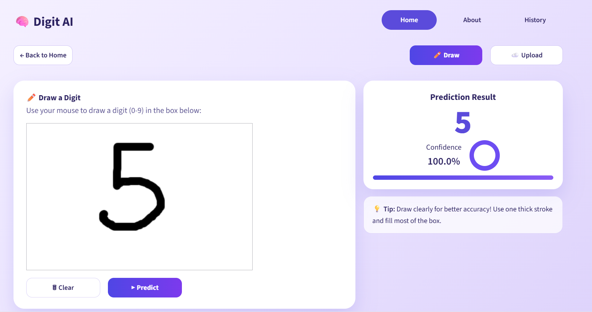
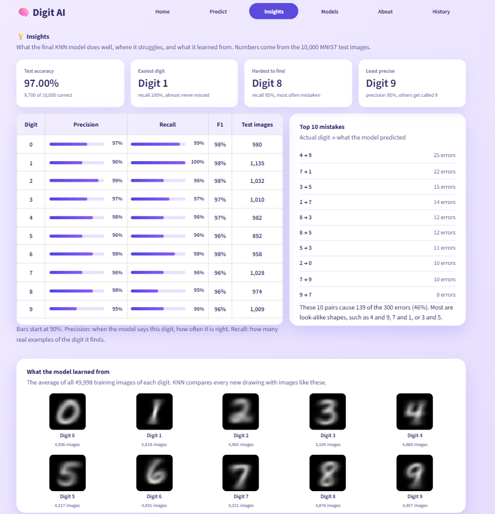
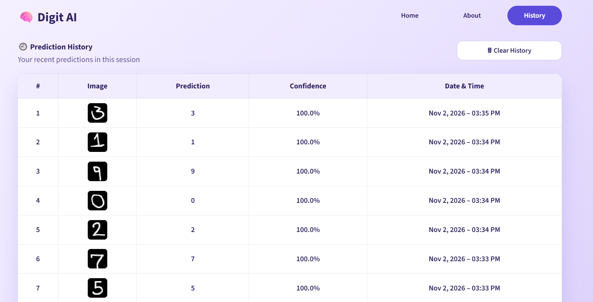

# Digit AI - Handwritten Digit Recognition

A Streamlit web app that recognizes handwritten digits (0-9). Draw a digit with your mouse or upload an image, and get an instant prediction with a confidence score, the top 3 guesses, and the training images that influenced the result.

[](https://digit-ai-sindhu.streamlit.app)

**Live demo:** [https://digit-ai-sindhu.streamlit.app](https://digit-ai-sindhu.streamlit.app)

## Features

- **Draw or upload:** draw a digit on a canvas, or upload a PNG / JPG / JPEG image
- **Instant prediction** with a confidence score
- **Top 3 predictions** with probabilities
- **"What the model sees":** the cleaned 28 x 28 input that is sent to the model
- **Nearest neighbors view:** the 3 MNIST training images behind each prediction
- **Insights page:** per-digit precision and recall, the top 10 mistakes, and the average image of each digit
- **Models page:** comparison of 4 models and the final confusion matrix
- **Prediction history** for the session, with CSV download
- **Automatic preprocessing** (invert, stretch contrast, thicken thin strokes, crop, resize, center) so real drawings look like MNIST digits

## Pages

| Page | What it does |
|---|---|
| Home | Project overview and quick start |
| Predict | Draw a digit or upload an image and see the prediction details |
| Insights | Where the model is strong, where it makes mistakes, and what it learned from |
| Models | Accuracy of all four models and the final confusion matrix |
| About | Project details and contact links |
| History | Predictions from the current session, downloadable as CSV |

## Model

| Item | Value |
|---|---|
| Dataset | MNIST (70,000 images, 28 x 28 pixels) |
| Final model | K-Nearest Neighbors (k = 3, distance weighting) |
| Validation accuracy | 97.20% |
| Test accuracy | 97.00% (9,700 of 10,000 correct) |

Four models were compared on the validation set:

| Model | Accuracy |
|---|---|
| **K-Nearest Neighbors** | **97.20%** |
| Random Forest | 96.69% |
| Logistic Regression | 92.12% |
| Support Vector Machine | 91.36% |

KNN gave the best validation performance and was selected as the final model. The most common mistakes on the test set are 4 predicted as 9 (25 images) and 7 predicted as 1 (22 images).

## How it works

1. The drawing or uploaded image is converted to grayscale and made white-on-black like MNIST.
2. Thin pen strokes are thickened, the digit is cropped, resized to 20 pixels and centered in a 28 x 28 image.
3. The KNN model finds the 3 most similar MNIST training images.
4. The neighbors vote, and the result is shown with its confidence.

## Tech stack

Python, Streamlit, scikit-learn, NumPy, Pillow, streamlit-drawable-canvas

## Run locally

```bash
git clone https://github.com/sindhus56/handwritten-digit-recognition.git
cd handwritten-digit-recognition
python -m venv venv
venv\Scripts\activate          # Windows
pip install -r requirements.txt
streamlit run app.py
```

## Project structure

```
├── app.py                      # Streamlit app (6 pages)
├── final_knn_model.pkl         # trained KNN model
├── requirements.txt
├── notebook/
│   └── Handwritten_Digits_Recognition.ipynb
├── screenshots/                # app screenshots used in this README
└── .streamlit/config.toml
```

## Screenshots

### Home


### Predict: draw a digit


### Predict: upload an image


### Insights


### Prediction history


## Author

Developed by **Sindhu S**

[GitHub](https://github.com/sindhus56) · [LinkedIn](https://www.linkedin.com/in/sindhu-s56/) · sindhus5656@gmail.com