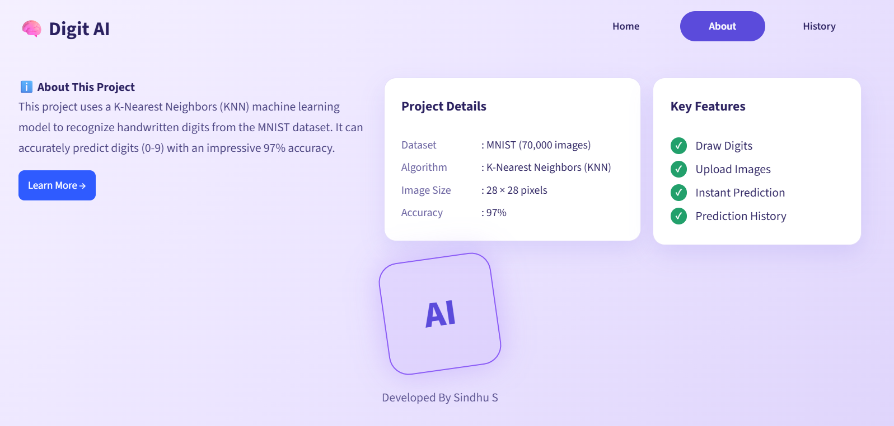

# Digit AI - Handwritten Digit Recognition

A Streamlit web app that recognizes handwritten digits (0-9). Draw a digit with your mouse or upload an image, and get an instant prediction with a confidence score.

**Live demo:** [https://digit-ai-sindhu.streamlit.app](https://digit-ai-sindhu.streamlit.app)

## Features

- Draw a digit on a canvas and predict instantly
- Upload a PNG / JPG / JPEG image of a digit
- Confidence score for every prediction
- Prediction history for the current session
- Automatic image preprocessing (invert, crop, thicken thin strokes, resize, center) so real drawings look like MNIST digits

## Model

| Item | Value |
|---|---|
| Dataset | MNIST (70,000 images, 28 x 28 pixels) |
| Algorithm | K-Nearest Neighbors (k = 3, distance weighting) |
| Validation accuracy | 97.20% |
| Test accuracy | 97.00% |

Four models were compared in the notebook (Logistic Regression, KNN, SVM, Random Forest). KNN gave the best validation performance and was selected as the final model.

## Tech stack

Python, Streamlit, scikit-learn, NumPy, Pillow, streamlit-drawable-canvas

## Run locally

```bash
git clone https://github.com/sindhus56/handwritten-digit-recognition.git
cd handwritten-digit-recognition
python -m venv venv
venv\Scripts\activate          # Windows
pip install -r requirements.txt
streamlit run app.py
```

## Project structure

```
├── app.py                      # Streamlit app (5 pages)
├── final_knn_model.pkl         # trained KNN model
├── requirements.txt
├── notebook/
│   └── Handwritten_Digits_Recognition.ipynb
├── screenshots/                # app screenshots used in this README
└── .streamlit/config.toml
```
## Screenshots

### Home


### Draw a digit


### Upload an image


### Prediction history


### About


## Author

Developed by **Sindhu S**